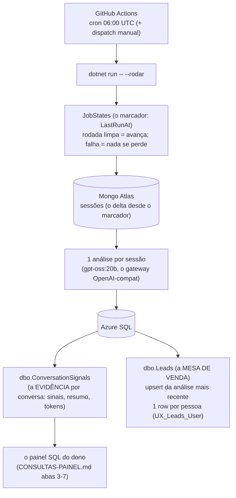

# AiCoachLeads — o mineiro de leads (R21)

Job console .NET 8 que **analisa as conversas** e transforma fala em material comercial:
sinais de intenção, um resumo por conversa e uma **mesa de leads** (as pessoas com disposição
de gastar — o estoque de venda futuro pra coaches e nutricionistas). Roda direto no runner do
GitHub, todos os dias, com cadência incremental (nada re-analisado).

## O desenho (este repo)



O **gate de acesso** (`dbo.Onboardings`, o antigo Leads) fica na API — não mora aqui.

## Como é uma rodada

1. Lê o marcador em `JobStates ('leads-miner')` (o marcador vazio = as últimas 72h).
2. Puxa do Mongo SÓ o delta: as sessões com input ou criação nova desde o marcador
   (as datas BSON chegam como array de ticks — o filtro e os helpers já embutidos em
   `SessionsPort`).
3. Uma chamada LLM por sessão (o briefing da conversa → JSON com sinais/resumo/intenção).
4. APPEND na evidência (`ConversationSignals`) + o UPSERT na mesa (`Leads`).
5. O marcador avança **só em rodada sem falha** — falha de rede/LLM = a próxima rodada
   re-analisa a janela e o dedupe idempotente não duplica nada.

## As PARAMETRIZAÇÕES

| Knob | Onde | Padrão | Para que; efeito |
|---|---|---|---|
| `--ver` (default) | console | — | leitura SEM custo: o marcador, as sessões novas, o estado. Primeiro comando sempre |
| `--rodar` | console | — | a rodada real (o delta → LLM → SQL) |
| `--max-sessions=N` | console | ilimitado | janela da rodada (cap de sessões analisadas: pra rodada de teste ou pós-falha grande) |
| `--dry` | console | — | monta o briefing e imprime — NEM LLM NEM gravação (prova de contexto) |
| `ConnectionStrings:SqlServer` | env/user-secrets | — | o SQL (o miner NUNCA apaga nada: o Leads é o estoque de venda) |
| `ConnectionStrings:MongoConnection` | env/user-secrets | — | o Mongo (leitura, nunca grava) |
| `Agent:ApiKey` / `Agent:Model` | env/user-secrets | ollama `gpt-oss:20b` ($0.07/1M) | o modelo da análise (trocar = config) |
| `JanelaInicial = 72h` | código (`AnalisadorDeSessoes`) | 72h | o piso do marcador quando a row do JobStates não existe |
| cron | `.github/workflows/leads.yml` | `0 6 * * *` | a cadência (06:00 UTC = 03:00 BRT). Editar a linha = editar a cadência |
| o marcador | `dbo.JobStates ('leads-miner')` | — | a régua da incremental — mexer com o dedo REANALISA o período |

**Régua comercial (do dono):** o `Leads` é estoque de VENDA — NUNCA "cleanup em massa".
Os testes usam telefone marcado e limpam por telefone específico.

## Segredos (GitHub / o padrão)

`AGENT_APIKEY` / `MONGO_CONN` / `SQL_CONN` como env do job do workflow (os secrets do repo)
— os mesmos nomes que `Program.cs` lê. O secret `AZURE_CREDENTIALS` + a variable `ACR_NAME`
não são usados AQUI (o rodada corre no runner, sem imagem/ACA).

## Estrutura / rodando

```
src/AiCoach.Leads        — o Program (os modos), Application (AnalisadorDeSessoes, MinerPrompt),
                           Infrastructure (SessionsPort Mongo, RepositoriosSql, MinerAgent)
tests/AiCoach.Leads.Tests — fakes do LLM/Mongo/SQL (8/8 na hora do corte R21)
```

```bash
dotnet build AiCoachLeads.sln -c Release
dotnet test  AiCoachLeads.sln -c Release
dotnet run --project src/AiCoach.Leads -- --ver        # primeiro comando sempre
```

Deploy/cadência: **push em master** = o workflow roda os testes; o cron diário e o
dispatch (`inputs.rodar=true`) disparam a rodada com os secrets do repo (colados pelo dono).

## Status

- 3 sinais de R21 capturados e 2 leads na mesa; o painel SQL: `CONSULTAS-PAINEL.md` abas 3
  (a mesa), 4 (acionáveis), 5 (temas), 6 (a evidência) e a aba 15 (o estado dos jobs).
- **Os secrets do cron (`AGENT_APIKEY`/`MONGO_CONN`/`SQL_CONN`) seguem PENDENTES** no repo
  (hoje só `AZURE_CREDENTIALS` está colado): colar os 3 no web (`Settings → Secrets → Actions`)
  = o cron diário LIGA. Até lá o cron executa e falha sem custo (o padrão do miner: falha não
  avança o marcador, nada se perde).
